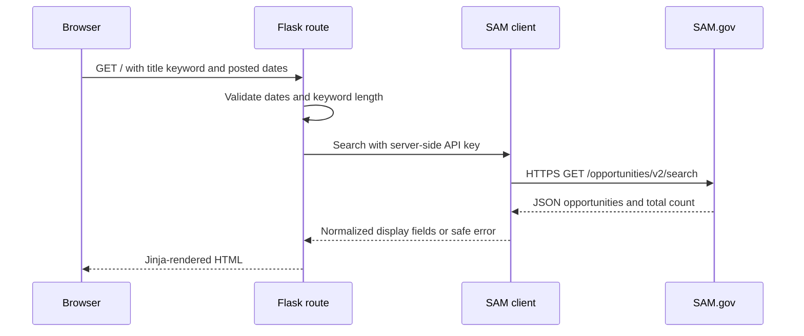
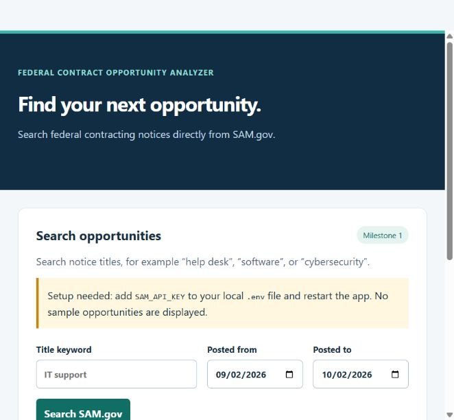
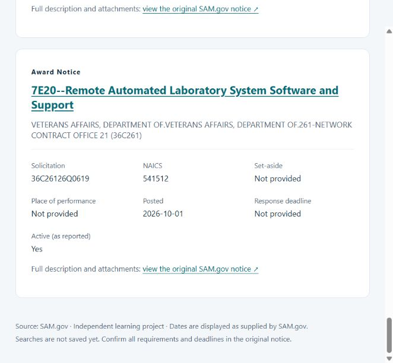

# Federal Contract Opportunity Analyzer

A learning project for finding and reviewing federal contracting notices from SAM.gov.
Built incrementally with AI assistance; features and verification are documented as they are completed.

## Milestone plan

1. Run Flask locally, request a small page of real SAM.gov notices, and display useful fields.
2. Add SQLite persistence, review statuses, and notes.
3. Add filters, a deadline dashboard, and CSV/Excel exports.
4. Develop explainable capability matching and document analysis.

Milestone 1's search-and-display flow is **verified with real SAM.gov data**.
No database, scoring, or document analysis is implemented.

## Stack

Python, Flask, Requests, Jinja HTML templates, and CSS. Pytest verifies request handling and display behavior.
SQLite, JavaScript, and Pandas will be introduced only when a feature needs them.

## Local setup (PowerShell, Python 3.12+)

```powershell
python -m venv .venv
.\.venv\Scripts\python.exe -m pip install -r requirements-dev.txt
Copy-Item .env.example .env
# Edit .env locally and set SAM_API_KEY. Never commit that file.
.\.venv\Scripts\python.exe -m flask --app app run --host 127.0.0.1
```

Open http://127.0.0.1:5000. This is a local development server.

On the original development machine, `.venv` has already been created using an available
Python 3.12 runtime because `python` was not on PATH. Run commands from this repository's
directory; you can skip environment creation and installation on that machine.
For another machine, install Python 3.12+ first. Do not copy the virtual environment between machines.

To reproduce the exact tested dependency versions instead of resolving the ranges above:

```powershell
.\.venv\Scripts\python.exe -m pip install -r requirements-lock.txt
```

## What works in this milestone

- A title keyword and posted-date search form with server-side validation.
- One API request per search, retrieving at most 10 notices from the first page.
- Display of title, organization hierarchy, solicitation number, NAICS, set-aside,
  place of performance, posted date, response deadline, notice type, and reported active status.
- Links to original SAM.gov notices; absent fields are labeled as not provided.
- Readable errors for missing keys, access denials, quota limits, timeouts, and unexpected responses.

The UI has no hard-coded opportunities and makes no request on initial page load.
Submitting or refreshing a search makes a new request and can consume API quota.
The title keyword uses SAM.gov's `title` parameter; it is not full-text description search.
The displayed notices are not restricted to open solicitations, and “active” does not imply
that a response deadline is still in the future. Results are not sorted locally or saved.

Full descriptions and attachments are available through the original notice link for now.
In the search response, `description` is an API URL rather than the description text; fetching
it would require an additional authenticated call. Description retrieval is deferred.

## Official source and credentials

[GSA Get Opportunities Public API documentation](https://open.gsa.gov/api/get-opportunities-public-api/)
was checked on October 2, 2026. Production searches use `https://api.sam.gov/opportunities/v2/search`.
Request a personal public API key through SAM.gov Account Details. The server reads `SAM_API_KEY`
from the environment or a local `.env` file. Environment variables take precedence.

Do not paste credentials into issues, screenshots, source files, or GitHub. `.env`, local data,
and the virtual environment are ignored by Git. No credential is needed to run isolated tests.

The API key is sent only from the Python server to the official HTTPS search endpoint.
Upstream error bodies and Requests exception text are not shown because they can contain
authenticated URLs. Redirects and automatic retries are disabled. Keep debug mode off when
using credentials, and do not enable verbose HTTP request logging.

## Project structure

```text
app/
  __init__.py          Flask factory and environment configuration
  routes.py            Form validation and page rendering
  sam_client.py        HTTP request, response checks, and field normalization
  templates/index.html
  static/style.css
tests/                Synthetic fixtures and isolated tests; network blocked
docs/                 Learning notes and verification checklist
.env.example          Empty configuration template
requirements*.txt     Dependency ranges and tested version snapshot
```

## How a search works



The browser never receives the API key. Flask handles the browser request; Requests handles
the separate server-to-SAM.gov request. The normalizer separates the external JSON schema
from the template. Jinja escapes returned text, so a notice title is displayed as text rather
than executable HTML. See [the milestone walkthrough](docs/milestone-1.md).

## Tests

```powershell
.\.venv\Scripts\python.exe -m pytest -q
```

As of October 2, 2026: **26 isolated tests pass** and `pip check` reports no dependency conflicts.
The server starts locally and the landing page was inspected in the browser. Tests use explicitly
synthetic notices and mock HTTP responses; they do not establish that a live API request succeeds.

An authenticated live search succeeded on October 2, 2026: title `software`, posted September 2
through October 2, returned 10 notices from 150 matches. The running app displayed the results
in a browser. One original SAM.gov notice was opened and its solicitation number, agency,
NAICS, location, set-aside, and response deadline matched the app. See the verification log
in `docs/milestone-1.md`. Counts will change as SAM.gov updates its data.

HTTPS uses the operating system's trusted certificates through `truststore`; certificate
verification remains enabled.





### Next milestone

- Review the request-to-display walkthrough before introducing persistence.
- Add SQLite persistence, saved opportunities, review statuses, and notes.

The application runs locally; no public deployment is configured.
