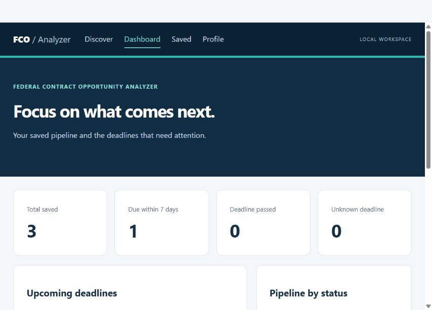
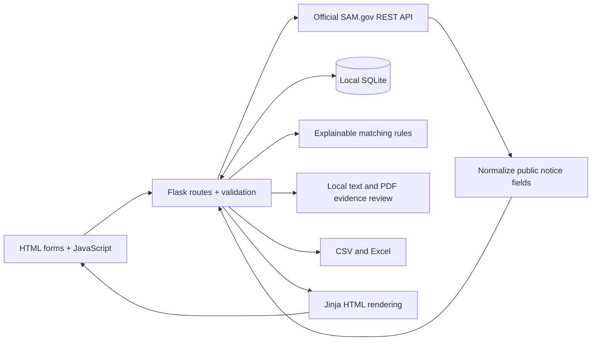

# Federal Contract Opportunity Analyzer

A local Python application for finding, evaluating, organizing, and tracking real federal
contracting notices from SAM.gov. Built incrementally with AI assistance, with documented
architecture, tests, and clear limits on what automated analysis can establish.

[](https://github.com/hmirza75/federal-contract-opportunity-analyzer/actions/workflows/tests.yml)

**v1.0.0 · Local, single-user application.** Uses real API data; no hard-coded opportunities.

## Features

- **Discover:** title keyword, agency, NAICS, set-aside, state/territory, posted dates,
  response-deadline range, notice type, and paginated results.
- **Track:** save source snapshots to SQLite; record notes and move through New, Interested,
  Reviewing, Bid, No-Bid, Submitted, Won, Lost, or Skipped. Re-saving preserves your research.
- **Plan:** dashboard with upcoming and passed deadlines, missing deadlines, and status counts.
- **Match:** configurable capability keywords, NAICS, locations, and set-aside preferences;
  weighted scores show every contribution, missing field, and caveat.
- **Review:** load official descriptions or analyze pasted text, UTF-8 TXT, and text-based PDF
  files. Extractive summaries organize evidence for scope, eligibility, dates, documents,
  technical requirements, and potential bid concerns. No external AI service is used.
- **Export:** filtered saved records, notes, and score explanations to CSV or formatted Excel.



## Run locally

Requires Python 3.12+ and Git. Windows PowerShell:

```powershell
git clone https://github.com/hmirza75/federal-contract-opportunity-analyzer.git
cd federal-contract-opportunity-analyzer
python -m venv .venv
.\.venv\Scripts\python.exe -m pip install -r requirements-lock.txt
Copy-Item .env.example .env
# Edit .env locally: SAM_API_KEY=your_key
.\.venv\Scripts\python.exe -m flask --app app run --host 127.0.0.1
```

macOS/Linux:

```bash
git clone https://github.com/hmirza75/federal-contract-opportunity-analyzer.git
cd federal-contract-opportunity-analyzer
python3 -m venv .venv
.venv/bin/python -m pip install -r requirements-lock.txt
cp .env.example .env
# Edit .env locally: SAM_API_KEY=your_key
.venv/bin/python -m flask --app app run --host 127.0.0.1
```

Open [localhost:5000](http://127.0.0.1:5000). Restart after changing `.env`.
Do not overwrite an existing `.env` when updating the project. The original development
workspace already has its virtual environment configured; use its `.venv` Python directly.

Request a personal public API key from **SAM.gov → Account Details**. See the
[official GSA API documentation](https://open.gsa.gov/api/get-opportunities-public-api/).
Despite its name, keep the key private. Never paste it into GitHub issues, screenshots, or code.

Without a key, the app still opens, and locally saved records, matching, document review,
and exports remain usable. Live search and description retrieval need the key.
No data is silently substituted when the API fails.

## Five-minute demonstration

1. Search for `software` over the last 30 days. Under **More search filters**, choose a
   solicitation notice type to avoid award notices. Leave filters broad if no results appear.
2. Save a result. On its detail page, change the status and add a research note.
3. Open **Dashboard**, then **Saved** to filter and export the record.
4. Configure **Profile** with your own keywords and optional NAICS/location/set-aside preferences.
5. Load the SAM.gov description on the detail page. Inspect the score breakdown and source
   excerpts. Try a local TXT/PDF document to see the evidence review.
6. Restart the app and confirm your saved record and notes remain.

Each search page costs one API request. Loading a description costs another. Quotas depend
on your SAM.gov account. There are no background requests, automatic retries, or bulk downloads.

## Architecture



| Layer | Technology |
| --- | --- |
| Server and API integration | Python, Flask, Requests, python-dotenv, truststore |
| Local persistence | SQLite through Python's sqlite3 module |
| Interface | Jinja, HTML, CSS, a small JavaScript file |
| Form protection | Flask-WTF CSRF and ItsDangerous signed result snapshots |
| Documents and exports | pypdf, openpyxl, Python csv and regex modules |
| Validation | Pytest, GitHub Actions |

[Architecture and interview walkthrough](docs/architecture.md) ·
[Verification record](docs/release-verification.md) · [Changelog](CHANGELOG.md)

## How matching and analysis work

Matching weights are keywords **50**, NAICS **30**, location **10**, and set-aside preference
**10**. Unconfigured categories are excluded. Keywords earn proportional credit; other
categories use exact matches. Missing source values earn zero and are flagged. The score is
`earned / configured points × 100`, rounded. It is relevance, not eligibility or win probability.
Search results use title/metadata; saved-detail scores can use descriptions and document text too.

Document review selects verbatim passages using explicit keyword rules. Every excerpt has a
passage reference; PDF page markers are retained. A scope overview repeats selected excerpts
rather than inventing facts. It does not resolve conflicting amendments, interpret law, or
understand every table or negation. Always read the original solicitation before deciding to bid.

## Tests

```powershell
.\.venv\Scripts\python.exe -m pytest -q
.\.venv\Scripts\python.exe -m pip check
```

Use `.venv/bin/python` on macOS/Linux. **56 tests pass locally.** All automated API responses
and notices are explicitly synthetic, and tests block network access. GitHub Actions runs the
suite on Windows and Linux. Live acceptance checks are documented separately.

## Local data and security

The first launch creates `instance/opportunities.sqlite3` and a session signing secret in
`instance/`. The database, `.env`, secrets, and virtual environment are ignored by Git.
Raw uploads are deleted after extraction; extracted text stays in the local database.
To back up your research, stop the app and copy the database to a private location. Restart it
normally afterwards. Never commit that backup. Exported files include your notes.

API keys are used only server-side. HTTPS verification remains enabled. Description requests
are restricted to official endpoints, redirects are disabled, SQL uses bound parameters,
HTML is escaped, and spreadsheet cells are protected against formula execution.

## Limits and future work

- This release is designed for a **local, single-user** workflow. It has no login or access roles;
  do not expose it to the public internet. Hosting requires separate authentication and deployment work.
- Keyword search searches notice titles, not every attachment or description.
- Saved records are snapshots. Re-save a search result to update its metadata; descriptions
  are fetched separately. Check SAM.gov for amendments and current deadlines.
- Rules provide transparent triage, not a semantic or generative AI analysis system.
- Uploads: 5 MB, 50 PDF pages, 150,000 text characters, and a 20-second PDF extraction timeout.
  Encrypted and scanned PDFs are not supported. No OCR or automatic attachment crawling.
- One current document review is retained per opportunity; a new review replaces it.
- Deadline timestamps without timezone information are explicitly marked and compared by
  UTC calendar date. Source timestamps remain visible.

Future extensions could include amendment history, authenticated multi-user hosting, OCR,
and evaluated semantic matching. These are not claimed as implemented features.
